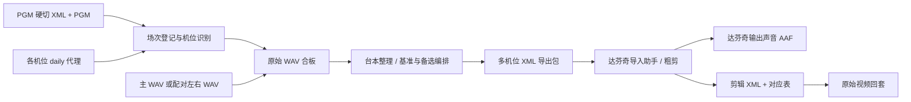

# 三木的 PGM 回套软件

**从现场 PGM 的切换结果，建立可继续剪辑、切换机位并回套原片的达芬奇多机位时间线。**

*A macOS tool for rebuilding live-switched PGM edits with camera proxies and production WAV audio in DaVinci Resolve.*


[安装与运行](docs/installation.md) · [操作流程](docs/workflow.md) · [技术架构](docs/architecture.md) · [已知问题](docs/known-issues.md)

## 它解决什么问题

剧场多机位拍摄往往同时留下现场导播的 PGM、各摄影机独立录制的原片、daily 代理和独立录音。PGM 可以提供剪接参考，但它已经是切换后的单路画面，无法直接恢复为可切换角度的多机位素材。

本软件读取**已经完成硬切分割的 PGM XML**，识别画面上烧录的机位标号，找到相应代理的源区间，再把已经合板的主 WAV 放到对应音轨。不同场次的完整 PGM 可以沿台本整理，并在基准时间线上自动初排、人工调整，最终输出达芬奇可继续编辑的多机位布局。

当前发布的是 **0.14.7 build47 的源码整理版**，不是已解决全部问题的通用剪辑产品。声音合板重试缓存等已知限制见下文及[问题清单](docs/known-issues.md)。

## 主要功能

| 功能 | 当前行为 |
| --- | --- |
| 自定义场次与机位 | 支持自定义拍摄日期、类型及 1–26 个机位；同场可登记多条 PGM、代理和录音。 |
| PGM 机位识别 | 框选标号区域，按稳定前缀识别，例如 `B0001` / `B003C001` → B；可配置旧素材的无标号机位。 |
| 代理多机位重建 | 每条 PGM 建立一个紧凑多机位资源，按切点及代理覆盖变化生成时间线片段。 |
| 原始声音合板 | 支持波形或仅时码同步；单个 mono / stereo WAV 直接引用，配对左右 WAV 可生成立体声文件。 |
| 台本与备选整理 | 支持中英文台词转写、台本区间关联、完整 PGM 整理、双窗口预览和人工编排。 |
| 基准与备选导出 | 支持仅基准、仅备选、基准＋备选三种多机位 XML；Vn 对应 An，并恢复声画链接。 |
| 原始视频回套 | 用达芬奇粗剪 XML 和配套代理／原片对应表，将视频引用替换为已配对原片。 |
| 本地项目 | `.pgmproj` 保存素材引用、识别、合板及编排信息；支持本地盘或已挂载的 NEXIS 工作区。 |

## 工作流程



1. 在达芬奇中检查 PGM 的硬切分割，导出 **Final Cut Pro 7 XML**；保持完整 PGM 时长，不变速。
2. 在软件中登记场次、机位、切点 XML、PGM、daily 代理及主 WAV，完成机位与同步核对。
3. 合板并检查声音覆盖。按台本整理备选，选定基准通条，在实际时间线上初排、调整和确认位置。
4. 导出所需模式的 XML 文件包，通过配套达芬奇导入助手导入。
5. 在达芬奇完成粗剪和声音 AAF 交付；画面锁定后，用剪辑 XML 与 `proxy_original_map.json` 回套视频原片。

跨场编排使用台词和人工位置，不用不同场次的源时码强行对齐。移动备选只改变时间线位置，保留其源素材时码与原速。详细步骤见[操作流程](docs/workflow.md)。

## 从源码运行

需要 **macOS 和 Python 3.12**。OCR 使用 macOS Vision；当前不提供 Windows / Linux 支持。

```bash
git clone https://github.com/sanmu0724/sanmu-pgm-conform.git
cd sanmu-pgm-conform
python3.12 -m venv .venv
source .venv/bin/activate
python -m pip install --upgrade pip
python -m pip install -r requirements.txt
python app.py
```

台词识别是可选功能；手动编排和 XML 导出不需要语音模型。启用自动转写时安装 `speech_requirements.txt`，**Intel Mac 还应使用 `constraints-intel.txt` 的兼容约束**。具体命令、桌面 App 构建和离线部署见[安装与运行](docs/installation.md)。

GitHub 源码 ZIP **不包含** Python 安装器、离线依赖包、语音模型、摄影素材或项目数据。首次使用未缓存的语音模型需要下载；依赖和模型备齐后可离线处理。

## XML 导出与声音规则

导出时请保留整个文件包：

| 文件 | 用途 |
| --- | --- |
| `*_MULTICAM.fcpxml` | 代理多机位时间线。 |
| 同名 `.resolve.lua` | 达芬奇导入、位置校验和声画链接助手。 |
| 同名 `.resolve-audio.aaf` | 有 WAV 声音时生成的内部导入适配文件，用于固定音轨位置。 |
| `proxy_original_map.json` | 代理与原片身份、配对声音及参考画面信息。 |
| 同名 `.reference.json` | 基准／备选布局与来源记录。 |
| `camera_coverage_report.json` | 代理覆盖、机位回退与 PGM 参考画面区间。 |

在达芬奇中先创建帧率正确的项目，再通过 **工作区 → 脚本 → 三木_导入多机位XML** 选择 XML。桌面安装器会安装该菜单入口。不要把内部 `.resolve-audio.aaf` 当作声音部门的最终交付 AAF。

- 主声音只使用已合板 WAV；没有覆盖的区间保持无声，不自动使用 PGM 或代理内嵌音频。
- 所有机位代理均无覆盖时，以 **`PGM_REF`** 角度保留原 PGM 画面，该区间不附声音，也不会自动回套成摄影机原片。
- 导入后 V1/A1 为基准；备选分布在上方视频轨及同编号音轨，默认禁用。仅备选导出启用最低实际视频轨及其对应音轨。
- 左右单声道合并后，新立体声 WAV 是交接所需媒体；原 L/R 不改写，来源关系另存对应表。
- **导入报告通过只说明已导出的片段通过校验，不代表所有 PGM 都成功匹配了录音。**

## 技术组成

Python + PyQt6 构建桌面界面，PyAV 负责媒体解码，macOS Vision 负责机位标号 OCR，NumPy 用于波形分析；可选 faster-whisper 提供 CPU 台词转写。FCPXML、配套 JSON 和原始 WAV 引用承担剪辑交换，内部音频 AAF 由 pyaaf2 生成。模块划分和时间坐标处理见[技术架构](docs/architecture.md)。

本项目保留本地项目存储和缓存，不提供多人协作服务。NEXIS 由其官方客户端挂载，软件读取挂载后的文件路径。

## 当前限制与后续方向

- 当前流程面向**硬切**，不承诺叠化、变速及复杂复合剪辑往返。
- 波形合板使用固定偏移；参考声差异或长条漂移可能导致匹配失败。
- 有效的历史失败缓存可能被继续复用；再次点击合板不一定重新计算。界面部分旧提示与当前无 WAV 留空策略仍存在差异。
- 跨场台词匹配仅用于初排，重复台词、即兴表演及无台词镜头需人工核对。
- 声音 AAF 的字段保留和最终多轨录音回套需要与声音部门实测；视频 XML 往返不保证保留声音亚帧采样位置。

后续优先方向是明确的失败重试、可追溯的合板诊断、长条录音同步、多平台依赖验证，以及大规模素材交互性能。详见[已知问题](docs/known-issues.md)。

## 反馈与许可

反馈请附软件版本、系统与 CPU 架构、操作步骤及脱敏后的诊断信息。请勿上传真实剧本、演出画面、录音、私密工程或包含个人路径的完整日志。开发说明见 [CONTRIBUTING.md](CONTRIBUTING.md)。

**本仓库尚未指定开源许可证。** 源码可见不等于已授予任意使用、修改或再分发许可；第三方依赖和模型分别遵循各自的许可证。本项目不是 Blackmagic Design、Avid 或 Pomfort 的官方产品。
