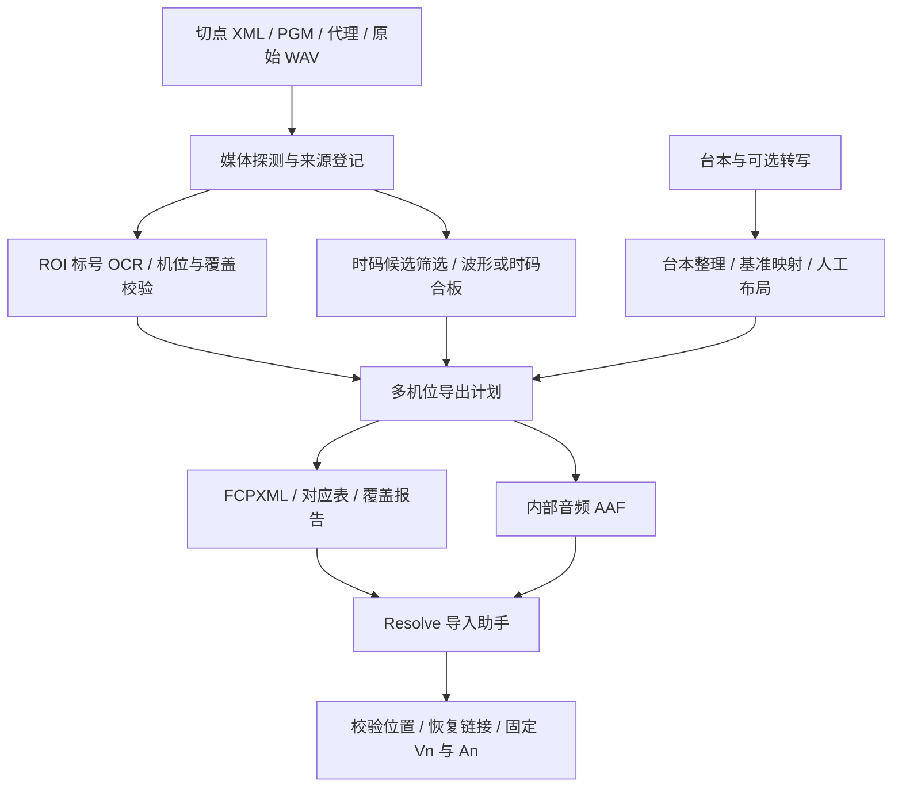

# 技术架构

本文对应 0.14.7 build47。它描述源码当前实现，不将规划功能列为已完成能力。

## 数据链路

软件以一场拍摄为素材登记单位，以一条完整 PGM 为多机位资源单位，以导出的时间线片段为画面／声音链接单位。

## 主要模块

| 范围 | 主要文件 | 职责 |
| --- | --- | --- |
| 应用与界面 | `app.py`、`pgm_app.py`、`ui_theme.py` | 入口、场次操作及 Qt 界面。 |
| 媒体与切点 | `core.py`、`cut_xml.py`、`media_cache.py` | 媒体属性读取、切点区间、帧率和覆盖检查。 |
| 机位 | `camera_schema.py`、`ocr.py`、`preview_search.py` | 自定义机位、标号区域与识别结果。 |
| 声音 | `sound_sync.py`、`waveform_sync.py`、`sync_candidates.py` | 候选录音筛选、波形偏移及时间码合板。 |
| 声音登记 | `library_sync.py`、`registered_sound.py`、`sound_fallback.py` | 合板缓存、有效性校验和未覆盖区间。 |
| 配对录音 | `sound_pairs.py`、`stereo_merge.py` | 左右单声道配对、立体声生成与来源记录。 |
| 台本与转写 | `dialogue_engine.py`、`speech_runtime.py`、`baseline_script_map.py` | 台本文本、语音识别及基准映射。 |
| 编排 | `manual_timeline.py`、`manual_timeline_ui.py`、`automatic_alignment.py` | 完整 PGM 的轨道位置、自动初排和人工确认。 |
| XML 与回套 | `multicam_xml.py`、`reference_timeline.py`、`fcpxml_conform.py` | 代理多机位、组合布局及原片替换。 |
| 达芬奇适配 | `resolve_import_helper.py`、`resolve_audio_interchange.py` | Lua 助手、音频 AAF、导入校验和链接。 |
| 项目与本地存储 | `local_project.py`、`project_state.py`、`library_store.py` | 项目身份、保存、素材归类和内部数据索引。 |

名称中保留 `library` 的模块是历史实现的一部分。当前工作流使用单机本地项目，不要求部署共享服务或多人数据库。

## 三种时间坐标

必须区分以下坐标，不能用一个时间码替代所有位置：

1. **源素材坐标**：代理／原片的帧位置、WAV 的采样位置及真实源时码。
2. **PGM 内部坐标**：每条 PGM 的局部起点为 0，多机位角度在这一范围内组织。
3. **剪辑时间线坐标**：基准串接及备选摆放后的位置，带有输出时间线起始时码。

画面用帧计数；音频位置在同步及交换时保留有理数／采样信息。XML 出点按不包含尾帧处理。跨场移动只改变记录位置，不重写源素材的时码，也不按两个拍摄日的钟表时间强配台词。

## 机位与多机位资源

输入切点来自已分割的 PGM XML。软件在镜头内取样，读取指定 ROI 的标号，按配置的稳定前缀映射到机位。条号、卷号变化不必对应一套新规则；未能确认的结果需要人工核对。

每条 PGM 只建立一个覆盖其自身范围的多机位资源，角度集合取该范围内实际存在唯一代理覆盖的机位。覆盖边界发生变化时，导出计划可继续拆分时间线片段。角度列在资源中，并不意味着它在整条 PGM 的每一帧都有录制。

已选机位缺录但有其他可用角度时，默认优先 A，再按配置顺序选择，并写复核标记。全部角度均无覆盖时，明确引用原 PGM 为 `PGM_REF`，保留时长而不延伸摄影机素材；该回退段无音频。

## 声音同步与导出

波形模式先用可用时码缩小候选，再比较 PGM 参考声与独立主 WAV。底层波形分析使用频谱特征搜索和多处采样相关性检查，独立声道分别处理，避免简单混音造成抵消。当前结果是单个固定时间偏移，没有漂移校正或变速重采样。

仅时码模式直接使用媒体记录的时码关系，要求设备时码真实可靠。该模式不会纠正时码本身的偏差。

单文件录音保持原 WAV 引用。配对左右 WAV 在导出时按原采样交织成新的立体声文件，不修改原文件；新媒体保留一致的公共字段，并以独立身份记录与原 L/R 的对应关系。缺失字段不臆造。

没有匹配 WAV 的区间保持无声。PGM 和摄影机的内嵌声音可用于分析与预览，但不作为新版导出时间线的声音来源。

## Resolve 导入适配

公开 FCPXML 描述多机位及关联信息。配套助手生成／使用内部画面导入结构，并通过 `.resolve-audio.aaf` 将声音安排到确定的物理音轨，随后校验来源、源入点、记录位置及轨号，恢复声画链接。设计目标是 Vn 对应 An，而不是让原生 FCPXML 导入器按音频空隙重新分轨。

导入成功报告是对**导出计划内的片段**进行校验。若计划中某条 PGM 未合板，静音本来就是计划的一部分，报告成功并不能证明其录音覆盖完整。应同时查看声音合板和代理覆盖报告。

助手在失败时撤回本次新时间线，原有时间线保留；媒体池可能仍有新导入条目。内部音频 AAF 不替代剪辑完成后从达芬奇导出的声音交付 AAF。

## 缓存与响应

媒体属性、缩略图、OCR、波形特征、转写和合板分别缓存；语音模型按需加载并复用，媒体身份及相关设置用于判断缓存有效性。轨道界面优先绘制可见范围，拖动操作不重新跑识别或同步。

缓存也有已知问题：历史合板失败可能被复用，且相关失败签名不含算法版本。此问题尚未在当前版本修复，不能把重复操作等同于重新分析。完整限制见[已知问题](known-issues.md)。
